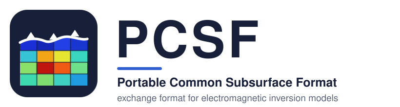
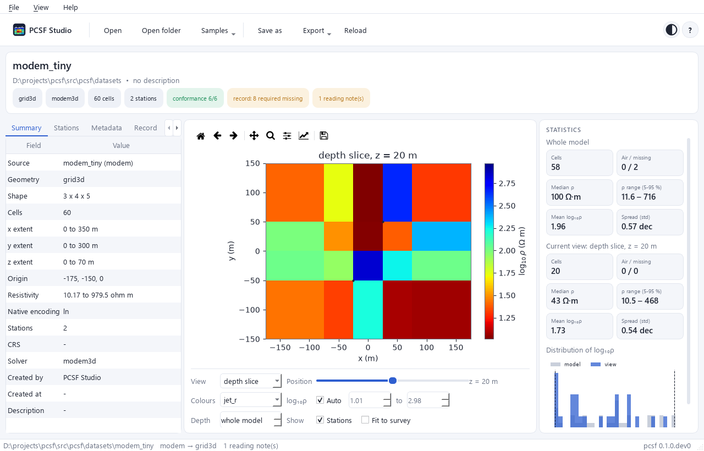
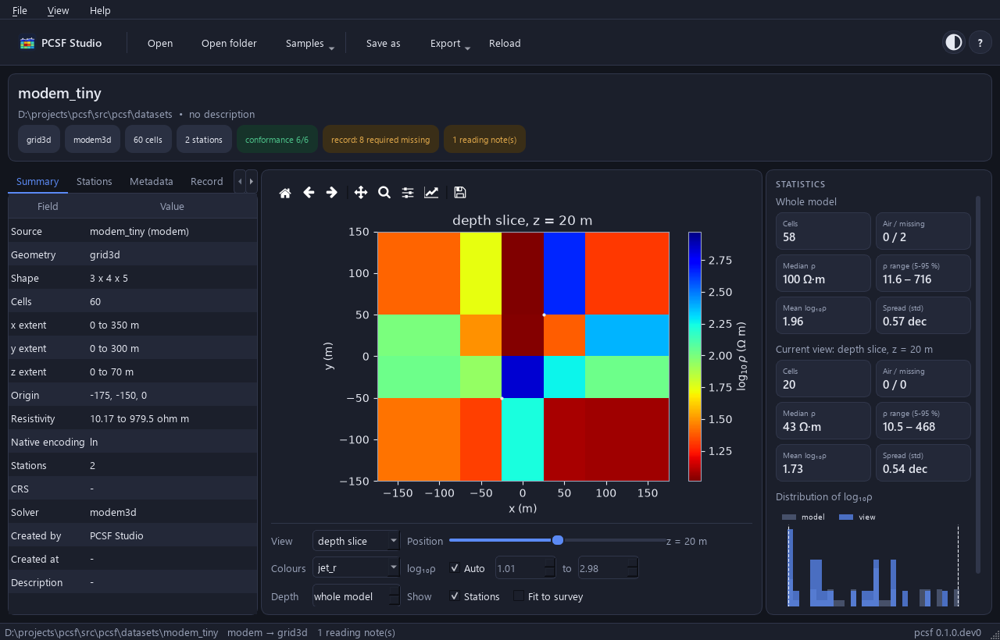
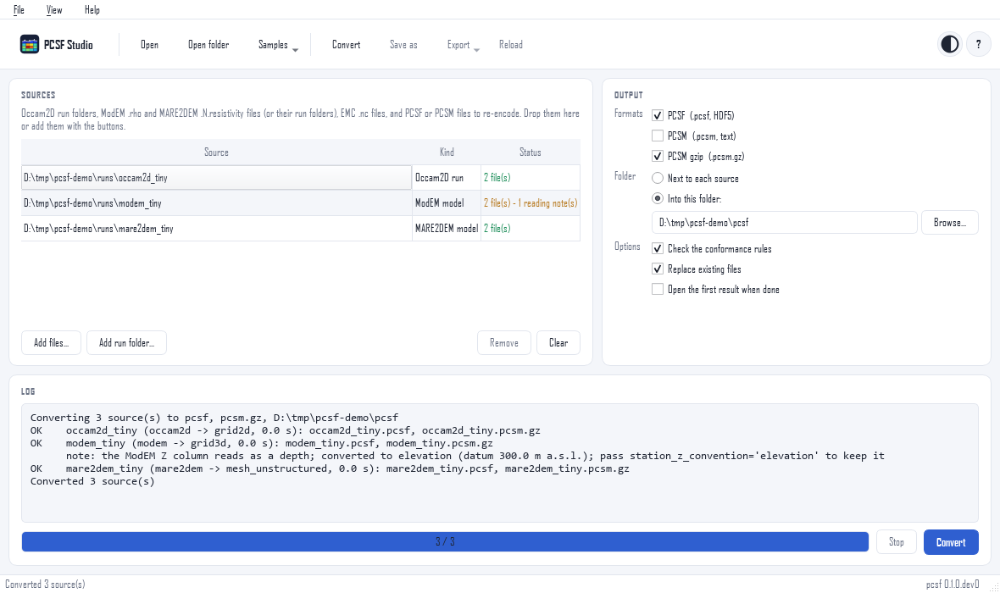

<div align="center">
  <picture>
    <source media="(prefers-color-scheme: dark)" srcset="docs/_static/logo/pcsf-logo-dark.svg">
    
  </picture>
  <br/>
  <em>One exchange format for electromagnetic inversion models &mdash; read, check, compare and convert, whatever code produced them.</em>
  <br/><br/>
  <a href="https://pypi.org/project/pcsf/"></a>
  <a href="https://github.com/earthai-tech/pcsf/releases/latest"></a>
  <a href="https://github.com/earthai-tech/pcsf/actions/workflows/ci.yml"></a>
  <a href="https://pcsf.readthedocs.io/en/latest/"></a>
  <a href="https://codecov.io/github/earthai-tech/pcsf"></a>
  <a href="https://opensource.org/licenses/BSD-3-Clause"></a>
  <br/>
  
  
  
  
  <a href="https://github.com/astral-sh/ruff"></a>
  <br/>
  <a href="https://pypi.org/project/pcsf/"></a>
  <a href="https://github.com/earthai-tech/pcsf/commits/master"></a>
  <a href="https://github.com/earthai-tech/pcsf/issues"></a>
  <a href="https://github.com/earthai-tech/pcsf/pulls"></a>
  <a href="CODE_OF_CONDUCT.md"></a>
  <br/><br/>

**[Documentation](https://pcsf.readthedocs.io)** ·
[Specification](spec/pcsf-0.1.md) ·
[Quick start](#quick-start) ·
[PCSF Studio](#pcsf-studio) ·
[Changelog](CHANGELOG.md)

</div>

---

## 🧭 Why PCSF?

Every inversion code writes its own format, with its own logarithm
base, axis order, coordinate frame, depth datum and discretization.
A reader who does not know these conventions misreads the model, and
the errors are as large as the geological contrasts the model is meant
to show. **PCSF states the conventions in the file**, so a model can
be read, checked and compared without knowing the code that made it.

| | What the file holds |
|---|---|
| 🎚️ **Canonical resistivity** | linear Ω·m, with the solver's own values and their encoding kept unchanged (`log10`, `ln`, `linear`, `log10_conductivity`, `conductivity`, or a plugin encoding) |
| 🧱 **Native geometry** | 2D section (`grid2d`), 3D grid (`grid3d`), triangular mesh (`mesh_unstructured`) or set of profiles (`multiline`) — never resampled |
| 🗺️ **Spatial reference** | station table, topography, coordinate reference system |
| 📋 **Inversion record** | data, errors, solver, regularization, misfit, convergence and depth of investigation, with a completeness check |
| ✅ **Conformance** | rules C1–C10, checked by every reader and by `pcsf validate` |

One model, two encodings that convert into each other **bit for bit**:
**PCSF** (HDF5, binary, compressed) and **PCSM** (plain text, comments
allowed, optionally `.pcsm.gz`).

## 🚀 Installation

```bash
pip install pcsf              # core: NumPy + h5py only
pip install "pcsf[all]"       # + algorithms, EMC, MARE2DEM, CRS, schemas, Studio
```

Requires **Python 3.9+**.

<details>
<summary><b>Optional extras &amp; source install</b></summary>

| Extra | Installs | For |
|---|---|---|
| `algorithms` | SciPy, Matplotlib | sampling, registration, comparison of models |
| `emc` | netCDF4 | EarthScope / IRIS Earth Model Collaboration archives |
| `mare2dem` | triangle | triangulation of MARE2DEM meshes |
| `geo` | pyproj | coordinate reference systems |
| `schema` | jsonschema | validation of the metadata against the JSON Schemas |
| `studio` | PySide6, Matplotlib | PCSF Studio, the graphical application |
| `all` | all of the above | |

From the repository:

```bash
git clone https://github.com/earthai-tech/pcsf.git
cd pcsf
pip install -e ".[all,dev]"
pytest
```

</details>

<a id="quick-start"></a>

## ⚡ Quick start

```python
import pcsf

model = pcsf.read("model.pcsf")           # .pcsf, .pcsm or .pcsm.gz, detected from content
print(pcsf.info(model))
pcsf.validate(model).raise_if_failed()    # conformance rules C1-C10
pcsf.write(model, "model.pcsm.gz")        # lossless text copy
```

<details>
<summary><b>Convert solver output (Occam2D, ModEM, MARE2DEM, EMC)</b></summary>

No inversion package is needed: the native files are parsed by pcsf
itself.

```python
from pcsf.adapters import (
    emc_to_pcsf, mare2dem_to_pcsf, modem_to_pcsf, occam2d_to_pcsf,
)

m = occam2d_to_pcsf("occam_run/")                        # run folder
m = modem_to_pcsf("run/m_NLCG_100.rho", data="run/d.dat")
m = mare2dem_to_pcsf("demo.6.resistivity", log="demo.logfile")
m = emc_to_pcsf("WUS-MT-2021.nc")
pcsf.write(m, "model.pcsf")
```

| Solver | Adapter | Geometry kind |
|---|---|---|
| Occam2D | `occam2d_to_pcsf` | `grid2d` |
| ModEM | `modem_to_pcsf` | `grid3d` |
| MARE2DEM | `mare2dem_to_pcsf` | `mesh_unstructured` |
| EMC netCDF | `emc_to_pcsf` (and back: `pcsf_to_emc`) | `grid3d` (geographic) |

Other codes plug in through the `pcsf.adapters` entry point (see
[CONTRIBUTING.md](CONTRIBUTING.md)).

</details>

<details>
<summary><b>Sample and compare two models</b></summary>

```python
from pcsf.algorithms import compare_log10, sample_log10

# log10(rho) of each model at the same points of its frame
a = sample_log10(model_a, points)
b = sample_log10(model_b, points)
result = compare_log10(a, b)    # difference, RMS, bias, correlation
print(result)
```

The sampling is multilinear on grids and exact on meshes; the weights,
the frame registration and the propagation of uncertainty are exposed
in `pcsf.algorithms`.

</details>

<details>
<summary><b>Command line</b></summary>

```bash
pcsf info model.pcsf                 # summary of a file
pcsf validate *.pcsf                 # conformance rules C1-C10
pcsf convert model.pcsf model.pcsm   # PCSF <-> PCSM <-> PCSM gzip
pcsf compare a.pcsf b.pcsf           # difference of two models
pcsf studio model.pcsf               # open PCSF Studio
pcsf version
```

</details>

<a id="pcsf-studio"></a>

## 🖥️ PCSF Studio

A viewer, inspector and converter for PCSF models and solver runs.

<p align="center">
  
</p>

- 🔎 **Open** `.pcsf` / `.pcsm` files, Occam2D, ModEM and MARE2DEM runs,
  and EMC netCDF files — or drop them on the window.
- 🗺️ **Draw** sections, depth slices, meshes and lines, with topography
  and stations.
- 📋 **Inspect** stations, metadata, the inversion record and the
  conformance rules; the statistics panel collapses to the right to
  give the plot more room.
- 🔁 **Convert** any number of solver runs to `.pcsf`, `.pcsm` or
  `.pcsm.gz` on the Convert page.
- 📤 **Export** figures (PNG, SVG, PDF) and CSV tables; light and dark
  themes.

```bash
pip install "pcsf[studio]"
pcsf-studio model.pcsf          # or: pcsf studio, python -m pcsf.studio
```

<details>
<summary><b>Installers without Python, and embedding</b></summary>

Each [release](https://github.com/earthai-tech/pcsf/releases/latest)
carries installers that need no Python:

| Platform | File | Install |
|---|---|---|
| Windows 10/11 (64-bit) | `pcsf-studio-<version>-setup.exe` | run the installer |
| Linux (x86-64) | `pcsf-studio-<version>-x86_64.AppImage` | `chmod +x` and run |
| Linux (x86-64) | `pcsf-studio-<version>-linux.sh` | `sh pcsf-studio-<version>-linux.sh` (installs in `~/.local`) |

They are built by [installers/build.py](installers/README.md).
`pcsf-studio --self-test` checks an installation without a window.

The widget that shows one model, `pcsf.studio.ModelView`, can be
embedded in other Qt applications; pyCSAMT's desktop app uses it.

</details>

<details>
<summary><b>Screenshots: dark theme and Convert page</b></summary>

<p align="center">
  
  <br/><br/>
  
</p>

</details>

## 🧩 Project

<details>
<summary><b>Repository layout</b></summary>

| Path | Content |
|---|---|
| `spec/` | versioned specification and PCSM grammar (EBNF); JSON Schemas in `src/pcsf/schemas/` |
| `conformance/` | reference files and expected values for independent implementations |
| `src/pcsf/api/` | **stable public API**: facade, base classes, types, registry |
| `src/pcsf/core/` | data model, encodings, versioning, HDF5 and text I/O, records, conformance |
| `src/pcsf/algorithms/` | sampling, point location, comparison, uncertainty, projection, registration |
| `src/pcsf/native/`, `adapters/` | solver parsers and converters (Occam2D, ModEM, MARE2DEM, EMC) |
| `src/pcsf/plugins/` | entry-point discovery (`pcsf.encodings`, `pcsf.adapters`, `pcsf.formats`) |
| `src/pcsf/cli/`, `studio/` | command-line tool, graphical application |
| `installers/` | Windows `.exe`, Linux `.AppImage` / `.sh` builds |
| `paper/` | reproduction of the paper |

Everything under `pcsf.api` (and re-exported by `pcsf`) follows
semantic versioning; other modules are internal.

</details>

<details>
<summary><b>Status and roadmap</b></summary>

Version 0.1.0.dev0, format version 0.1.0.

| Phase | Content | Status |
|---|---|---|
| 1 | core data model and algorithms | ✅ |
| 2 | solver parsers and adapters, conformance suite, JSON Schemas | ✅ |
| 3 | pyCSAMT uses pcsf as its format core | ✅ |
| 4 | PCSF Studio and its installers | ✅ |
| 5 | reproduction of the paper ([paper/](paper/README.md)) | ✅ |
| — | first release on PyPI | ⏳ |

See [CHANGELOG.md](CHANGELOG.md).

</details>

<details>
<summary><b>Contributing</b></summary>

Issues and pull requests are welcome; see
[CONTRIBUTING.md](CONTRIBUTING.md) and the
[code of conduct](CODE_OF_CONDUCT.md). New solvers, encodings and
companion formats can be added as plugins without changing pcsf.

</details>

## 📖 Citing

If you use pcsf, please cite it as given in
[CITATION.cff](CITATION.cff) (GitHub's *Cite this repository* button
gives APA and BibTeX). The format and its algorithms are described in a
manuscript in preparation for *Geophysics*.

## ⚖️ Licence

BSD 3-Clause. See [LICENSE](LICENSE).
