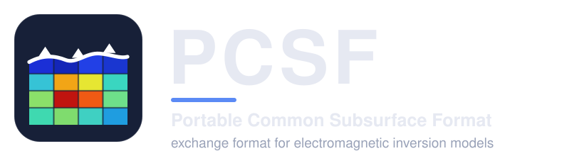
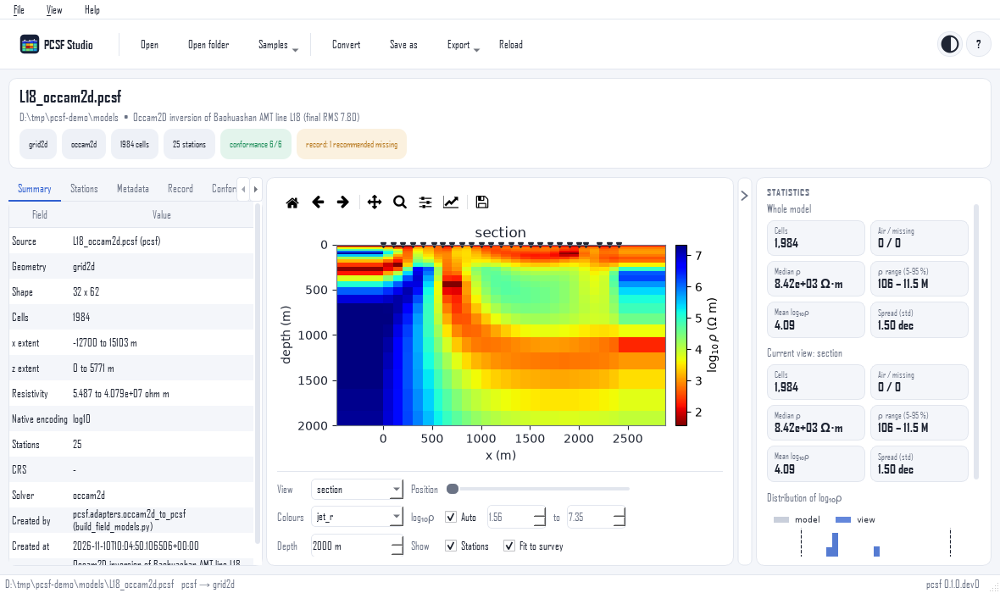

:html_theme.sidebar_secondary.remove:

.. title:: pcsf: Portable Common Subsurface Format

.. raw:: html

   

.. rst-class:: pcsf-tagline

One exchange format for electromagnetic and magnetotelluric
inversion models: read, check, compare and convert them, whatever
code produced them.

.. button-ref:: getting_started/index
   :ref-type: doc
   :color: primary
   :class: pcsf-hero-button

   Get started

.. button-ref:: studio/index
   :ref-type: doc
   :color: secondary
   :outline:
   :class: pcsf-hero-button

   PCSF Studio

.. button-link:: https://github.com/earthai-tech/pcsf
   :color: secondary
   :outline:
   :class: pcsf-hero-button

   Source on GitHub

.. raw:: html

   

Why PCSF?
---------

Every inversion code writes its own format, with its own logarithm
base, axis order, coordinate frame, depth datum and discretization.
A reader who does not know these conventions misreads the model,
and the errors are as large as the geological contrasts the model
is meant to show. PCSF states the conventions in the file.

.. grid:: 1 2 4 4
   :gutter: 3
   :class-container: pcsf-why

   .. grid-item-card:: Canonical resistivity
      :class-card: pcsf-why-card

      Linear Ω·m for every model, with the solver's own values and
      their encoding kept unchanged.

   .. grid-item-card:: Native geometry
      :class-card: pcsf-why-card

      2D grid, 3D grid, triangular mesh or set of profiles, never
      resampled.

   .. grid-item-card:: Spatial reference
      :class-card: pcsf-why-card

      Station table, topography and coordinate reference system in
      the same file.

   .. grid-item-card:: Inversion record
      :class-card: pcsf-why-card

      Data, errors, regularization, misfit, convergence and depth
      of investigation, with a completeness check.

One model has two encodings that convert into each other bit for
bit: **PCSF** (HDF5, binary, compressed) and **PCSM** (plain text,
optionally ``.pcsm.gz``).

In a few lines
--------------

.. tab-set::

   .. tab-item:: Python

      .. code-block:: python

         import pcsf

         model = pcsf.read("model.pcsf")          # or .pcsm, .pcsm.gz
         pcsf.validate(model).raise_if_failed()   # rules C1-C10
         pcsf.write(model, "model.pcsm.gz")       # lossless text copy

   .. tab-item:: Solver output

      .. code-block:: python

         from pcsf.adapters import modem_to_pcsf, occam2d_to_pcsf

         model = occam2d_to_pcsf("occam_run/")    # run folder
         model = modem_to_pcsf("run/m_NLCG_100.rho", data="run/d.dat")
         pcsf.write(model, "model.pcsf")

   .. tab-item:: Command line

      .. code-block:: bash

         pcsf info model.pcsf
         pcsf validate *.pcsf
         pcsf convert model.pcsf model.pcsm
         pcsf compare a.pcsf b.pcsf

   .. tab-item:: PCSF Studio

      .. code-block:: bash

         pip install "pcsf[studio]"
         pcsf-studio model.pcsf     # or a run folder

      Or download an installer that needs no Python; see
      :doc:`studio/install`.

Documentation
-------------

.. grid:: 1 2 3 3
   :gutter: 3

   .. grid-item-card:: Getting started
      :link: getting_started/index
      :link-type: doc
      :class-card: pcsf-nav-card

      Install the package, read and write a first model, and use
      the command line.

   .. grid-item-card:: User guide
      :link: user_guide/index
      :link-type: doc
      :class-card: pcsf-nav-card

      The data model, encodings, solver adapters, inversion record,
      conformance rules and algorithms.

   .. grid-item-card:: PCSF Studio
      :link: studio/index
      :link-type: doc
      :class-card: pcsf-nav-card

      The desktop application: view, inspect and convert models
      without writing code.

   .. grid-item-card:: API reference
      :link: api/index
      :link-type: doc
      :class-card: pcsf-nav-card

      Every public function and class, with examples.

   .. grid-item-card:: Specification
      :link: specification
      :link-type: doc
      :class-card: pcsf-nav-card

      The file format itself, for readers written in any language.

   .. grid-item-card:: Development
      :link: developer/index
      :link-type: doc
      :class-card: pcsf-nav-card

      Architecture, plugins for new solvers and encodings, and how
      to contribute.

PCSF Studio
-----------

   An Occam2D section in PCSF Studio, with stations, statistics and
   the inspector. :doc:`Tour of the application <studio/tour>`.

Citing and licence
------------------

The format and its algorithms are described in a manuscript in
preparation for *Geophysics*; until it is published, cite the
software with the metadata of ``CITATION.cff`` in the repository.
pcsf is released under the BSD 3-Clause licence. This documentation
describes package version |release| and format version
|format_version|.

.. toctree::
   :hidden:

   getting_started/index
   user_guide/index
   studio/index
   api/index
   specification
   changelog
   developer/index
