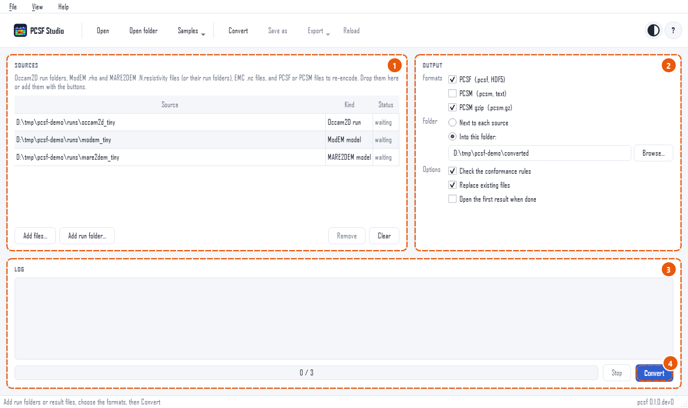
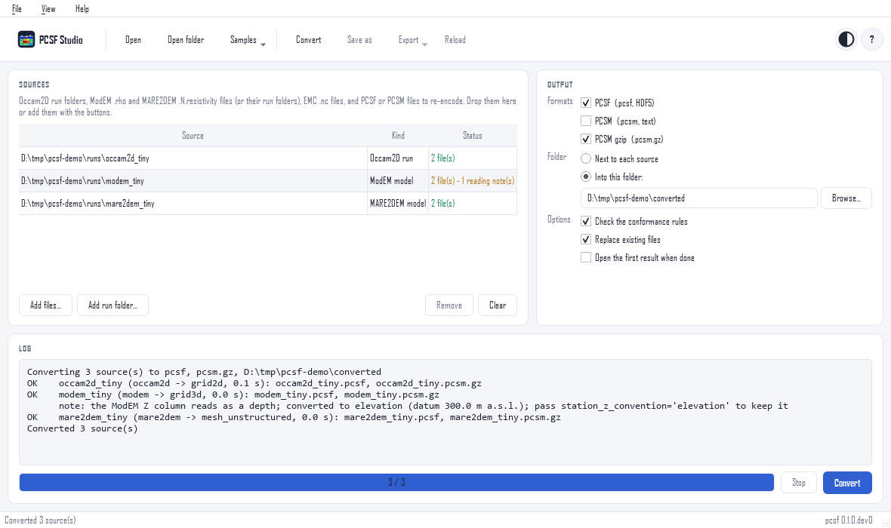

Converting solver runs
======================

The *Convert* page turns any number of solver results into PCSF
files in one go. Open it with *Convert* in the toolbar,
:kbd:`Ctrl+Shift+C`, or *Convert runs...* on the start page.

   Three runs ready to convert.

Step by step
------------

1. **Add the sources.** *Add files...* for result files,
   *Add run folder...* for a run folder, or drop files and folders
   on the page. The list shows the kind of each source; a file that
   is neither a solver result nor a model is skipped with a line in
   the log.

   .. list-table::
      :header-rows: 1
      :widths: 26 74

      * - Source
        - What to add
      * - Occam2D
        - the run folder (with ``Occam2DMesh`` or ``ITER*.iter``);
          the last iteration is converted
      * - ModEM
        - a ``.rho`` model, or the run folder; the data file and the
          log next to it are read when there is one of each
      * - MARE2DEM
        - a ``.N.resistivity`` model, or the run folder
      * - EMC
        - a netCDF file (``.nc``)
      * - PCSF, PCSM
        - a ``.pcsf``, ``.pcsm`` or ``.pcsm.gz`` file, to write it in
          another encoding

2. **Choose the output.** One or more formats: *PCSF* (``.pcsf``,
   binary, the one to share), *PCSM* (``.pcsm``, plain text, to
   read or keep under version control) and *PCSM gzip*
   (``.pcsm.gz``). Then where to write them: next to each source,
   or into one folder. Each output is named after its source:
   ``m_NLCG_100.rho`` gives ``m_NLCG_100.pcsf``, the run folder
   ``L18PLT`` gives ``L18PLT.pcsf``.

3. **Set the options.**

   *Check the conformance rules*
      Each model is checked against the rules of the
      specification; failures are listed in the log, and the files
      are written all the same.
   *Replace existing files*
      Off by default: a source whose output exists is reported as
      failed and nothing is overwritten.
   *Open the first result when done*
      Shows the first converted model in the viewer.

4. **Convert.** The sources are converted one after another in the
   background, so the window stays responsive; the status column
   and the progress bar follow the run, and *Stop* ends it after
   the source being converted.

Reading the log
---------------

   After the run: the files written, and a reading note for the
   ModEM run.

Each source gets one line: ``OK`` with the source kind, the
geometry kind and the files written, or ``FAIL`` with the reason
(also in the tool tip of its status). Below an ``OK`` line come the
rules that failed and the reading notes, such as a station height
read as a depth and converted. A status in amber means the files
were written but something deserves a look.

The chosen formats and folder are kept for the next session.

The same in a script
--------------------

The page calls :func:`~pcsf.studio.convert.convert_source` once per
source; it needs no window:

.. doctest::

   >>> import tempfile
   >>> from pcsf.studio.convert import convert_source
   >>> with tempfile.TemporaryDirectory() as out:
   ...     res = convert_source(
   ...         pcsf.datasets.path("mare2dem_tiny"),
   ...         ["pcsf", "pcsm.gz"],
   ...         out_dir=out,
   ...     )
   ...     [p.name for p in res.outputs], res.model_kind
   (['mare2dem_tiny.pcsf', 'mare2dem_tiny.pcsm.gz'], 'mesh_unstructured')

For one model, the adapters of :doc:`../user_guide/adapters` and
:func:`pcsf.write` give more control, and the command line converts
between encodings (``pcsf convert model.pcsf model.pcsm``).
