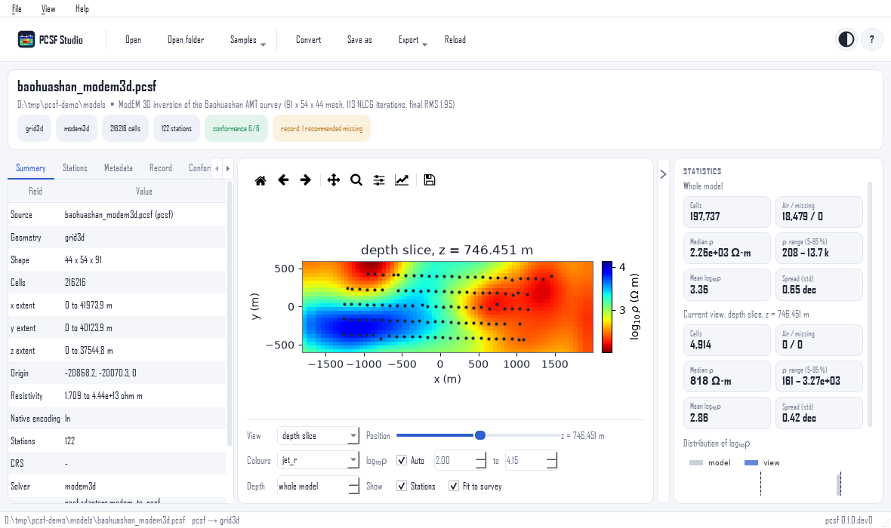

PCSF Studio
===========

PCSF Studio is the desktop application of pcsf. It opens inversion
models, whether ``.pcsf`` and ``.pcsm`` files or the native output of
Occam2D, ModEM, MARE2DEM and the EarthScope Earth Model Collaboration
(EMC), and shows them with their stations, topography, inversion
record and conformance. It converts solver runs to PCSF and PCSM in
batches. No programming is needed, and the application does not
change the models it opens.

   A depth slice of a ModEM 3D model, with the 122 stations of the
   survey. The inspector is on the left, the statistics on the
   right.

.. grid:: 1 2 3 3
   :gutter: 3

   .. grid-item-card:: Get the application
      :link: install
      :link-type: doc
      :class-card: pcsf-nav-card

      Installers for Windows and Linux that need no Python, or
      ``pip install "pcsf[studio]"``.

   .. grid-item-card:: Tour of the window
      :link: tour
      :link-type: doc
      :class-card: pcsf-nav-card

      What each part of the window shows, from the start page to
      the statistics.

   .. grid-item-card:: Viewing models
      :link: viewing
      :link-type: doc
      :class-card: pcsf-nav-card

      Opening files and run folders, the views of each geometry
      kind, the colour range and the exports.

   .. grid-item-card:: Converting solver runs
      :link: convert
      :link-type: doc
      :class-card: pcsf-nav-card

      Many Occam2D, ModEM, MARE2DEM or EMC results to ``.pcsf``,
      ``.pcsm`` or ``.pcsm.gz`` in one go.

   .. grid-item-card:: Reference
      :link: reference
      :link-type: doc
      :class-card: pcsf-nav-card

      Keyboard shortcuts, themes, settings, embedding the viewer,
      and answers to common questions.

What it opens
-------------

.. list-table::
   :header-rows: 1
   :widths: 30 40 30

   * - Source
     - What to open
     - Shown as
   * - PCSF, PCSM
     - ``.pcsf``, ``.pcsm``, ``.pcsm.gz`` file
     - the model's own geometry
   * - Occam2D
     - the run folder (``Occam2DMesh``, ``ITER*.iter``)
     - 2D section (``grid2d``)
   * - ModEM
     - a ``.rho`` model, or its run folder
     - depth slices and sections (``grid3d``)
   * - MARE2DEM
     - a ``.N.resistivity`` model, or its run folder
     - triangular mesh (``mesh_unstructured``)
   * - EMC
     - a netCDF file (``.nc``)
     - geographic 3D grid (``grid3d``)

A file in PCSF or PCSM can also hold a set of profiles
(``multiline``), shown one line at a time.

.. toctree::
   :hidden:

   install
   tour
   viewing
   convert
   reference
