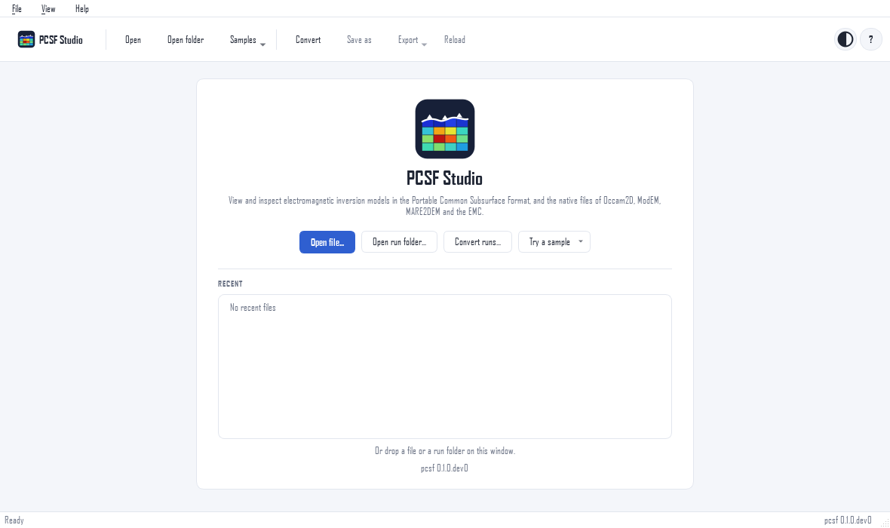

Get the application
===================

There are three ways to get PCSF Studio. Choose the first if you do
not use Python, the second if you do.

.. tab-set::

   .. tab-item:: Installer (no Python)

      Each `release on GitHub
      <https://github.com/earthai-tech/pcsf/releases/latest>`__
      carries installers that include everything the application
      needs.

      .. grid:: 1 1 3 3
         :gutter: 2

         .. grid-item-card:: Windows 10/11
            :class-card: pcsf-nav-card

            ``pcsf-studio-<version>-setup.exe``

            Run it and follow the steps. SmartScreen warns about
            unsigned installers: *More info*, then *Run anyway*.

         .. grid-item-card:: Linux AppImage
            :class-card: pcsf-nav-card

            ``pcsf-studio-<version>-x86_64.AppImage``

            ``chmod +x`` the file and run it; nothing is
            installed.

         .. grid-item-card:: Linux installer
            :class-card: pcsf-nav-card

            ``pcsf-studio-<version>-linux.sh``

            ``sh pcsf-studio-<version>-linux.sh`` installs it in
            ``~/.local`` with a menu entry, without root.

      The installers are attached to releases from version 0.1.0
      on. Until then, use pip, or build them with
      ``installers/build.py`` (see ``installers/README.md`` in the
      repository).

   .. tab-item:: pip

      .. code-block:: bash

         pip install "pcsf[studio]"

      This installs PySide6 and matplotlib next to pcsf, and three
      ways to start the application:

      .. code-block:: bash

         pcsf-studio                   # the start page
         pcsf-studio model.pcsf        # open a file or a run folder
         pcsf studio model.pcsf        # the same, from the pcsf tool
         python -m pcsf.studio         # the same, from Python

      Use a virtual or conda environment; PySide6 is large and is
      best kept apart from other Qt bindings.

   .. tab-item:: Inside pyCSAMT

      `pyCSAMT <https://github.com/earthai-tech/pycsamt>`__ uses
      pcsf as its format core, so installing pyCSAMT installs pcsf
      too. Its desktop application embeds the viewer of PCSF
      Studio; with the application extra of pyCSAMT (which brings
      PySide6), the ``pcsf-studio`` command works as well.

Starting
--------

.. code-block:: bash

   pcsf-studio                  # start page with recent files and samples
   pcsf-studio run_folder/      # Occam2D, ModEM or MARE2DEM run
   pcsf-studio --theme dark     # system (default), light or dark

The window opens centred on the screen, at 1180 by 700 pixels, or
three quarters of the screen when that is smaller. On Windows the
installer adds PCSF Studio to the Start menu and, if you tick the
options, a desktop icon and the association of ``.pcsf`` and
``.pcsm`` files, so that a double click opens them. The Linux
``.sh`` installer adds a menu entry.

   The start page: open a file or a run folder, convert runs, try a
   bundled sample, or reopen a recent file.

The bundled samples (*Try a sample*, or the *Samples* menu) are
three small runs of Occam2D, ModEM and MARE2DEM; they show every
part of the window without any data of your own.

Checking an installation
------------------------

.. code-block:: bash

   pcsf-studio --self-test
   pcsf-studio --self-test --report studio-check.txt

The self-test opens the samples, draws every view and converts a
model without showing a window, and ends with ``self-test passed``.
Send the report with a bug report if it fails.

.. dropdown:: The application does not start on Linux

   PySide6 needs a few system libraries that minimal installations
   lack. On Debian and Ubuntu:

   .. code-block:: bash

      sudo apt-get install libegl1 libgl1 libxkbcommon0 \
          libfontconfig1 libdbus-1-3

   The AppImage also needs FUSE (``libfuse2``); without it, run
   ``./pcsf-studio-<version>-x86_64.AppImage --appimage-extract``
   and start ``squashfs-root/AppRun``.

.. dropdown:: "No module named PySide6"

   pcsf was installed without its *studio* extra. Run
   ``pip install "pcsf[studio]"`` in the same environment.
