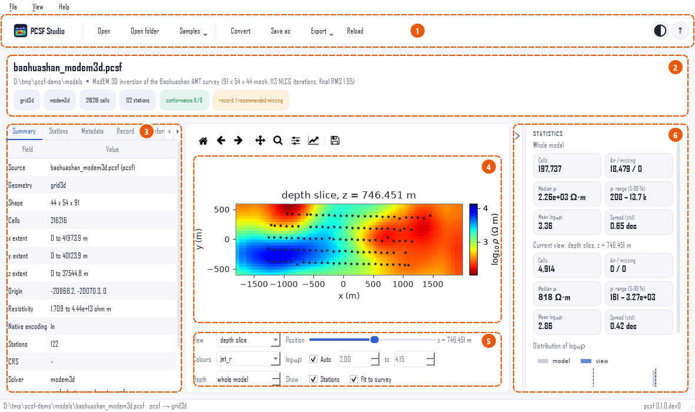
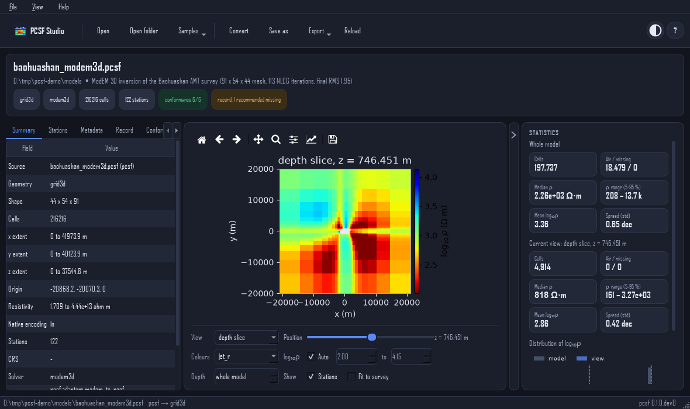

Tour of the window
==================

   The window with a ModEM 3D model open. The numbers refer to the
   list below.

1. **Toolbar.** The logo at the left brings back the start page.
   Then come *Open* (a file), *Open folder* (a run folder),
   *Samples*, *Convert* (the :doc:`convert` page), *Save as*,
   *Export* and *Reload*. At the right are the theme button (light,
   dark or follow the system) and the ``?`` menu (shortcuts,
   documentation, specification, about).
2. **Header.** File name, folder and description of the model, and
   chips that say at a glance what it is: geometry kind, producing
   code, number of cells and stations, the result of the
   conformance rules (green when all pass) and the completeness of
   the inversion record (amber when fields are missing).
3. **Inspector.** Tabs with everything the file holds besides the
   values: *Summary* (shape, extent, encoding, solver, coordinate
   reference system), *Stations* (names, positions, elevations,
   longitude and latitude), *Metadata* (the full tree), *Record*
   (the inversion record), *Conformance* (rule by rule) and, when
   there is something to report, *Reading* (notes written while a
   solver file was converted).
4. **Plot.** The model as a section, depth slice, mesh or line,
   with the stations and the topography. The matplotlib toolbar
   above it pans, zooms and saves.
5. **Controls.** The view, its position (slice depth, section
   coordinate or line), the colour map and the range of
   :math:`\log_{10}\rho`, a depth limit, and whether to show the
   stations and fit the axes to the survey.
6. **Statistics.** For the whole model and for the current view:
   cells, air and missing cells, median resistivity, the 5–95 %
   range, the mean and spread of :math:`\log_{10}\rho`, and a
   histogram of both. The view figures follow every change of
   position or range.

The inspector and the plot are separated by a splitter: drag it to
give one more room. The statistics collapse to a thin strip at the
right, see :ref:`studio-collapse`.

The inspector
-------------

.. grid:: 1 1 2 2
   :gutter: 3

   .. grid-item::

      .. figure:: ../_static/studio/inspector-record.png
         :alt: The Record tab of the inspector
         :class: pcsf-shot

         *Record*: what data were inverted, with which errors,
         regularization and misfit, and how the run ended.

   .. grid-item::

      .. figure:: ../_static/studio/inspector-conformance.png
         :alt: The Conformance tab of the inspector
         :class: pcsf-shot

         *Conformance*: each rule of the specification, passed or
         failed, with the reason.

The record and the conformance rules are described in
:doc:`../user_guide/inversion_record` and
:doc:`../user_guide/conformance`. A model converted from a solver
run carries what the run files state; fields they do not state are
listed as missing, never guessed.

The dark theme
--------------

   The same model with the dark theme.

The theme follows the system by default and changes with it; the
round button at the right of the toolbar, or :kbd:`Ctrl+T`, chooses
light or dark. Exported figures always have a white background.
