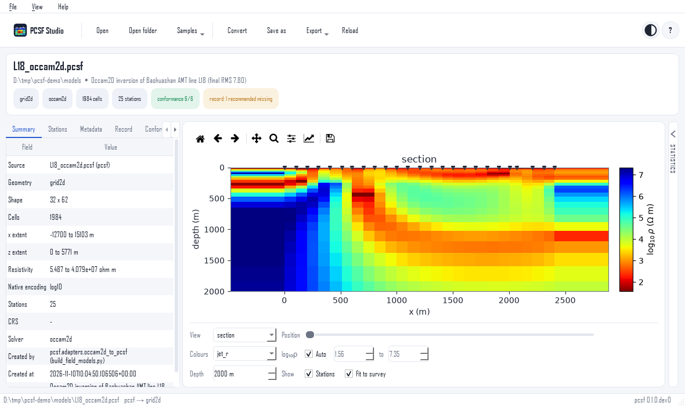

Viewing models
==============

Opening
-------

- **A file**: *Open* (:kbd:`Ctrl+O`), or drop it on the window:
  ``.pcsf``, ``.pcsm``, ``.pcsm.gz``, a ModEM ``.rho``, a MARE2DEM
  ``.N.resistivity`` or an EMC ``.nc`` file.
- **A run folder**: *Open folder* (:kbd:`Ctrl+Shift+O`), or drop
  it. The folder of an Occam2D, ModEM or MARE2DEM run is recognised
  from its files, and its last iteration is read.
- **A recent file**: from the start page or *File > Recent*.
- **A sample**: *Samples* in the toolbar.

A ModEM or MARE2DEM model is read with the data file and the log
next to it when there is exactly one of each, so that the stations
and the convergence history come with it. A file that cannot be
read leaves the model shown before in place; the message says why,
and *Show details* gives the full report. *Reload* (:kbd:`F5`)
reads the file again after a solver has rewritten it.

Views of each geometry kind
---------------------------

.. tab-set::

   .. tab-item:: 2D grid

      .. figure:: ../_static/studio/view-section.png
         :alt: An Occam2D section with topography and stations
         :class: pcsf-shot

         An Occam2D model of a Baohuashan line: one section, with
         the stations on the topography. *Fit to survey* and a depth
         limit of 2000 m hide the padding cells.

   .. tab-item:: 3D grid

      .. figure:: ../_static/studio/view-depth-slice.png
         :alt: A depth slice of a ModEM model
         :class: pcsf-shot

         A ModEM model: *depth slice*, *x section* and *y section*,
         moved through the volume with the *Position* slider.

   .. tab-item:: Triangular mesh

      .. figure:: ../_static/studio/view-mesh.png
         :alt: A MARE2DEM model on its triangular mesh
         :class: pcsf-shot

         A MARE2DEM model drawn on its own triangles, never
         regridded.

   .. tab-item:: Set of profiles

      .. figure:: ../_static/studio/view-lines.png
         :alt: One line of a multiline model
         :class: pcsf-shot

         Five Occam2D lines in one file: the slider steps from line
         to line.

.. list-table::
   :header-rows: 1
   :widths: 28 72

   * - Geometry kind
     - Views
   * - 2D grid (``grid2d``)
     - section
   * - 3D grid (``grid3d``)
     - depth slice, x section, y section
   * - triangular mesh (``mesh_unstructured``)
     - mesh
   * - set of profiles (``multiline``)
     - line (one profile at a time)

Air cells, whose resistivity is above :math:`10^{8}\ \Omega\,`\ m,
are left blank, so the topography shows as the upper edge of the
model.

The plot controls
-----------------

*Position*
   Depth of a slice, coordinate of a section, or line of a set of
   profiles; the arrow keys step one cell at a time.
*Colours*
   The colour map. ``jet_r`` puts conductors in red and resistors
   in blue, as most MT figures do; ``viridis`` and ``turbo_r`` are
   kinder to colour-blind readers.
:math:`\log_{10}\rho`
   The colour range. *Auto* takes the 2nd to the 98th percentile of
   the model; untick it to set the range, for example to compare
   two models on the same scale.
*Depth*
   The largest depth shown on sections; *whole model* shows all.
*Show*
   The station markers, and *Fit to survey*, which limits the
   horizontal axes to the extent of the stations.

The matplotlib toolbar above the plot pans and zooms; its *home*
button returns to the full view.

.. _studio-collapse:

More room for the plot
----------------------

   The statistics collapsed: the plot takes the whole width.

Click the thin strip at the left edge of the statistics panel, or
press :kbd:`Ctrl+2`: the panel slides to the right and stays as a
strip labelled *Statistics*. Click the strip again to bring it
back. :kbd:`Ctrl+1` hides the inspector in the same way, and the
splitters between the panels can be dragged. The layout is kept
for the next session.

Saving and exporting
--------------------

*Save as* (:kbd:`Ctrl+Shift+S`)
   The model as PCSF, PCSM or PCSM gzip. The three encodings hold
   the same model, so this converts a native solver file, or
   changes the encoding of a PCSF file, without loss.
*Export > Figure* (:kbd:`Ctrl+E`)
   The plot as PNG, SVG or PDF, on a white background.
*Export > Cells*
   One row per cell, with its position and resistivity, as CSV.
*Export > Stations*
   The station table as CSV.

To convert many files at once, use the :doc:`convert` page.
