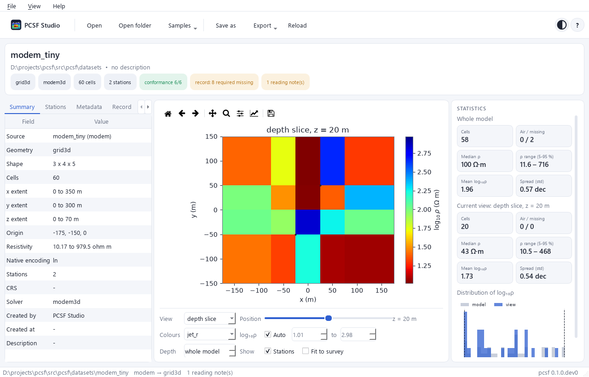
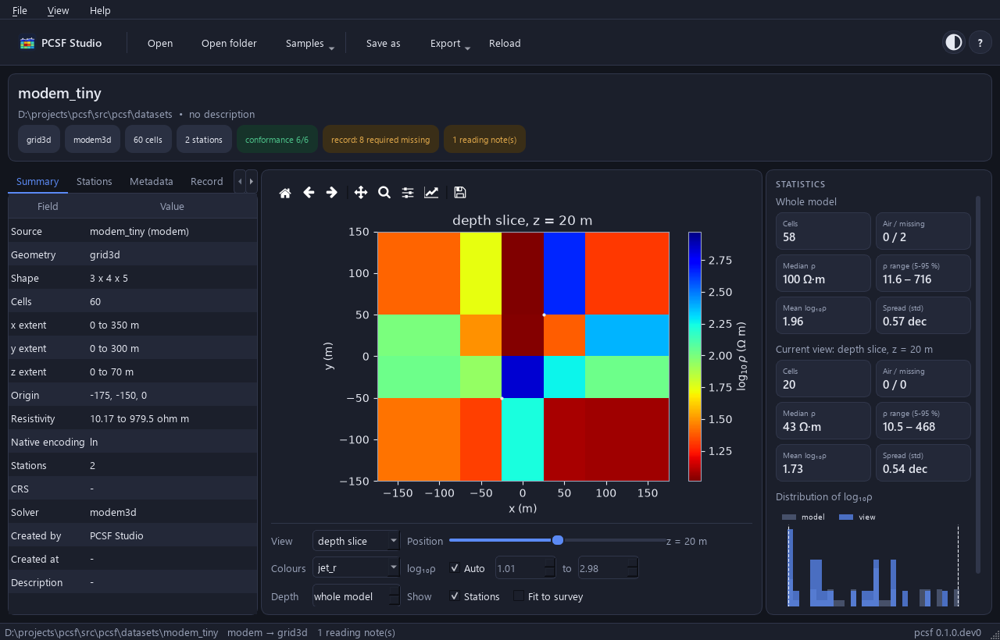

PCSF Studio
===========

PCSF Studio is a viewer and inspector. It opens ``.pcsf`` and
``.pcsm`` files, Occam2D, ModEM and MARE2DEM runs and EMC netCDF
files; draws sections, depth slices, meshes and lines; lists
stations, metadata, the inversion record and the conformance
rules; converts between PCSF and PCSM; and exports figures and CSV
tables. It does not edit models.

   A ModEM model: inspector on the left, plot and its controls in
   the centre, statistics on the right.

Starting
--------

.. code-block:: bash

   pip install "pcsf[studio]"
   pcsf-studio                  # or: pcsf studio, python -m pcsf.studio
   pcsf-studio model.pcsf       # open a file or a run folder
   pcsf-studio --theme dark     # system, light or dark
   pcsf-studio --self-test      # check an installation, no window

Installers that need no Python are attached to each release.

The window
----------

- **Toolbar.** The logo at the left leads to the start page. Then
  come *Open*, *Open folder*, *Samples* (three bundled runs),
  *Save as*, *Export* and *Reload*. At the right are the theme
  button and the ``?`` help menu.
- **Header.** File name, folder and description, with chips for
  the geometry kind, the solver, the number of cells and stations,
  the conformance result and the completeness of the inversion
  record.
- **Inspector.** Tabs *Summary*, *Stations*, *Metadata*, *Record*,
  *Conformance* and, when there is something to report, *Reading*.
- **Plot.** The view (section, depth slice, mesh or line), its
  position, the colour map, the range of
  :math:`\log_{10}\rho`, a depth limit, the station markers and
  the fit to the survey.
- **Statistics.** Cells, air and missing cells, median, 5-95 %
  range, mean and spread of :math:`\log_{10}\rho`, for the whole
  model and for the current view, with a histogram.

A file or a folder dropped on the window is opened. Panels whose
content does not fit get a scroll bar; the inspector and the
statistics can be hidden from the *View* menu.

Themes
------

   The dark theme.

The theme is light, dark, or follows the desktop. Plots follow the
theme on screen; exported figures are always on a white
background. The window remembers its theme, size and panel layout.

Keyboard shortcuts
------------------

.. list-table::
   :header-rows: 1
   :widths: 30 70

   * - Keys
     - Action
   * - :kbd:`Ctrl+O`
     - open a file
   * - :kbd:`Ctrl+Shift+O`
     - open a run folder
   * - :kbd:`F5`
     - reload the model from disk
   * - :kbd:`Ctrl+Shift+S`
     - save as PCSF, PCSM or PCSM gzip
   * - :kbd:`Ctrl+E`
     - export the figure
   * - :kbd:`Ctrl+Home`
     - start page
   * - :kbd:`Ctrl+1`, :kbd:`Ctrl+2`
     - show or hide the inspector, the statistics
   * - :kbd:`Ctrl+T`
     - switch between the light and the dark theme
   * - :kbd:`F1`
     - list of shortcuts

Without a window
----------------

The parts of the Studio that open and draw models need no Qt and
are usable in scripts:

.. doctest::

   >>> import matplotlib
   >>> matplotlib.use("Agg")
   >>> from matplotlib.figure import Figure
   >>> from pcsf.studio.sources import open_source
   >>> from pcsf.studio import figures
   >>> loaded = open_source(pcsf.datasets.path("modem_tiny"))
   >>> loaded.kind, loaded.model.kind
   ('modem', 'grid3d')
   >>> figures.views(loaded.model)
   ('depth slice', 'x section', 'y section')
   >>> ax = figures.draw(Figure(), loaded.model, "x section", index=2)
   >>> ax.get_xlabel(), ax.get_ylabel()
   ('y (m)', 'depth (m)')

Embedding
---------

:class:`~pcsf.studio.window.ModelView`, the widget that shows one
model, can be placed in another Qt application:

.. code-block:: python

   from pcsf.studio import ModelView
   from pcsf.studio.sources import open_source
   from pcsf.studio.style import DARK, style_sheet

   view = ModelView()
   view.setStyleSheet(style_sheet(DARK))
   view.set_theme(DARK)
   view.set_model(open_source("model.pcsf"))
   layout.addWidget(view)
